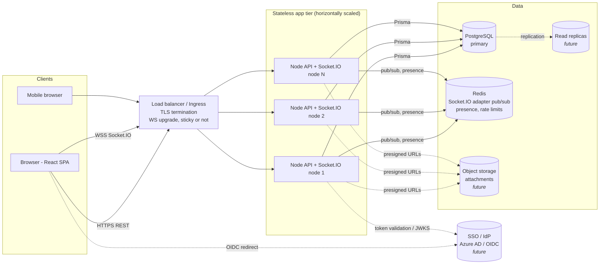

# High-Level Design — Enterprise Web Chat

## Architecture

Prototype scope: one Node process (API + Socket.IO), PostgreSQL in Docker, in-memory presence and rate limits behind interfaces so Redis can be dropped in. Dotted items are designed for, not built.

## Components

| Component | Responsibility |
|---|---|
| React SPA (Vite) | Login, conversation list, chat pane, optimistic sends, reconnect/backfill |
| Load balancer | TLS, WebSocket upgrade, health checks, spreading connections |
| API node (Express) | Auth, users, conversations, message history (REST). Stateless: JWT in httpOnly cookie |
| Socket node (Socket.IO) | Authenticated live channel: send/ack, fan-out, typing, presence, read markers |
| PostgreSQL | System of record: users, conversations, members, messages |
| Redis (future) | Socket.IO adapter for cross-node fan-out, shared presence counts, distributed rate limits |
| Object storage (future) | Attachments via presigned upload/download URLs; scanned for malware |
| IdP (future) | Corporate SSO (Azure AD/Entra via OIDC), MFA, SCIM provisioning/deprovisioning |

## Component communication

- **REST (HTTPS)** for commands and reads that need request/response and caching semantics: login, user search, creating conversations, paginated history.
- **WebSocket (Socket.IO)** for low-latency events: `message:send` (with ack), `message:new`, `typing:*`, `presence:update`, `conversation:read`.
- Sending a message goes over the socket for latency, but it is persisted *before* fan-out; the ack carries the server id. REST history is the source of truth for backfill after reconnect.
- Rooms: `user:{id}` (per user, all tabs/devices) and `conv:{id}` (per conversation). Fan-out = `io.to('conv:{id}').emit(...)`.

## External dependencies

- PostgreSQL 16 (Docker for dev, managed e.g. Azure Database for PostgreSQL / RDS in prod)
- Redis 7 (future, managed)
- Identity provider (future): Azure AD / any OIDC
- Object storage (future): S3 / Azure Blob
- Push providers (future): FCM/APNs/Web Push for offline notifications

## Scaling

1. **Horizontal WS nodes.** App nodes hold no durable state. With multiple nodes, add `@socket.io/redis-adapter` so `io.to(room).emit` reaches sockets on every node. Sticky sessions are only required if HTTP long-polling fallback is enabled; with `transports: ['websocket']` they are not.
2. **Presence** moves from the in-memory `PresenceStore` to Redis (`HINCRBY presence:{userId} nodeId`, TTL heartbeats so a crashed node's counts expire).
3. **Database.** Writes go to the primary; history reads and conversation lists can go to read replicas. Messages are the hot table: index `(conversation_id, created_at desc, id desc)`; at scale, partition `messages` by `hash(conversation_id)` (Postgres declarative partitioning, or Citus) so a conversation's history stays on one shard.
4. **Fan-out beyond Redis.** For very large groups/org-wide channels, publish `message.created` to Kafka; consumers handle fan-out, push notifications, search indexing (OpenSearch), and audit/eDiscovery export independently.
5. **Caching.** Membership lookups (`user ∈ conversation`) cached in Redis with invalidation on membership change; conversation list cached per user.
6. **Rate limiting** moves to Redis (`rate-limit-redis`) so limits are global, not per node.
