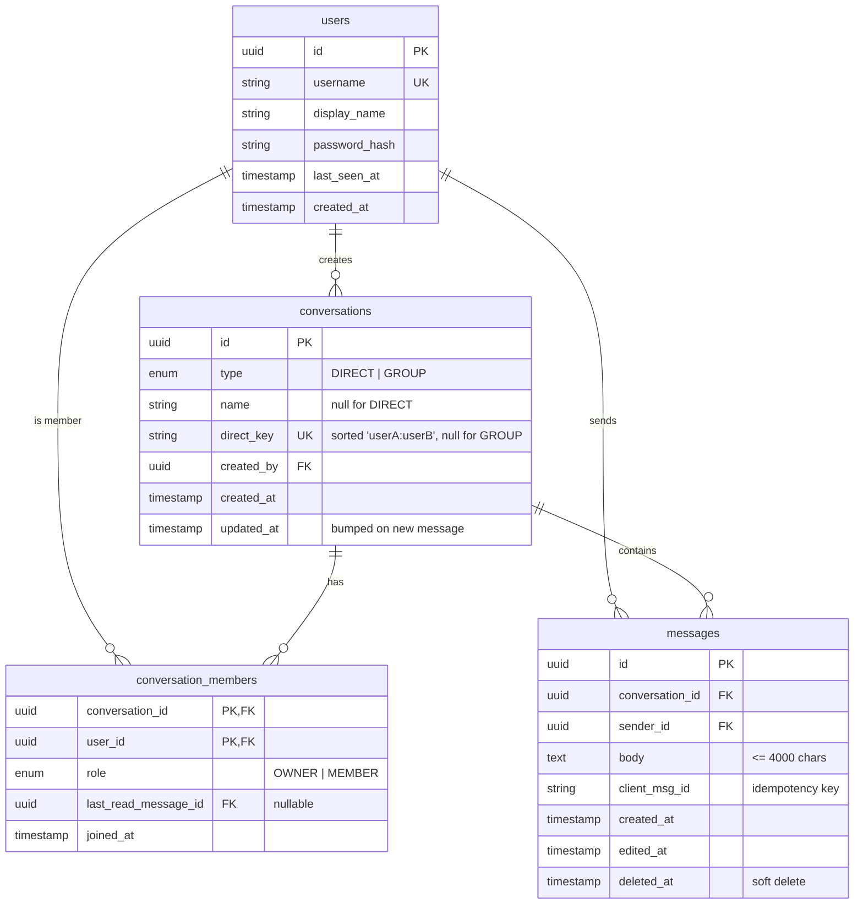
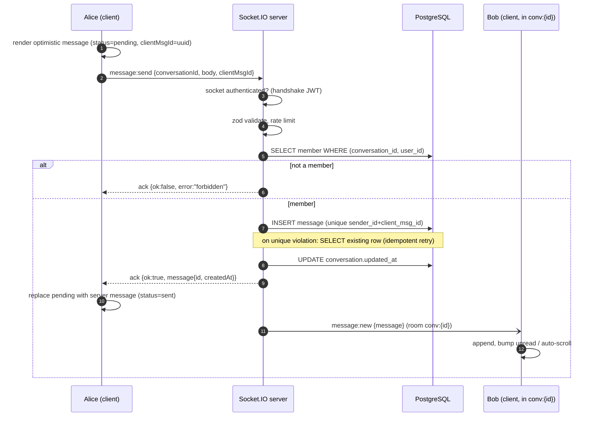
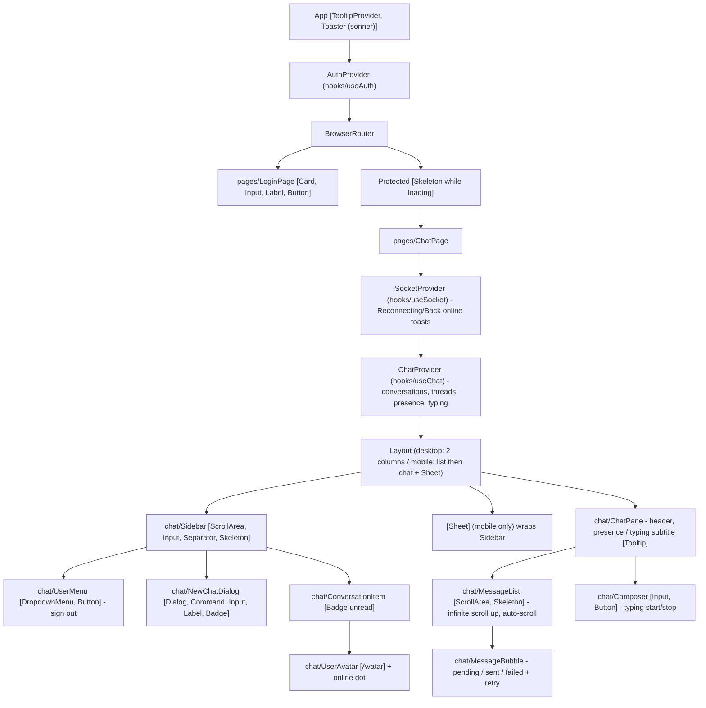

# Low-Level Design — Enterprise Web Chat

## Database schema (ERD)



### Indexes and constraints

| Table | Index | Why |
|---|---|---|
| messages | `(conversation_id, created_at DESC, id DESC)` | History pagination, last message per conversation |
| messages | `UNIQUE (sender_id, client_msg_id)` | Idempotent sends: a retried send returns the existing row |
| conversations | `UNIQUE (direct_key)` | One DM per pair. `direct_key = min(a,b) + ':' + max(a,b)`; NULL for groups (NULLs don't collide) |
| conversation_members | `PK (conversation_id, user_id)` + index `(user_id)` | Membership check; "my conversations" |
| users | `UNIQUE (username)` | Login |

Ordering within a conversation is `(created_at, id)`. Pagination cursor = the oldest message id the client has; server resolves it to `(created_at, id)` and returns rows strictly older (keyset pagination, no OFFSET).

## REST API

All routes except register/login require the `token` httpOnly cookie. JSON bodies validated with zod. Errors: `{ error: string }`.

| Method | Path | Body / Query | Response |
|---|---|---|---|
| POST | `/auth/register` | `{username, displayName, password}` | `{user}` + sets cookie |
| POST | `/auth/login` | `{username, password}` (rate limited) | `{user}` + sets cookie |
| POST | `/auth/logout` | – | `204`, clears cookie |
| GET | `/auth/me` | – | `{user, token}` (token returned so the SPA can pass it in the socket handshake if cookies aren't sent cross-origin) |
| GET | `/users?search=` | `search` (optional) | `{users: [{id, username, displayName, online, lastSeenAt}]}` |
| GET | `/conversations` | – | `{conversations: [{id, type, name, members[], lastMessage, unreadCount, updatedAt}]}` |
| POST | `/conversations/direct` | `{userId}` | `{conversation}` — idempotent, returns existing DM |
| POST | `/conversations/group` | `{name, memberIds[]}` | `{conversation}` — creator becomes OWNER |
| GET | `/conversations/:id/messages` | `cursor` (msg id, older-than), `after` (msg id, newer-than, for backfill), `limit` ≤ 100 (default 30) | `{messages (ascending), nextCursor \| null}` |
| GET | `/health` | – | `{ok, db}` |

Every `/conversations/:id/*` route runs `assertMember(userId, conversationId)` → `403` if not a member.

## Socket event contract

Handshake: cookie `token` or `auth: { token }`. Middleware verifies JWT; rejects with `unauthorized`. On connect the server joins `user:{id}` and `conv:{id}` for each membership, then increments presence.

| Direction | Event | Payload | Notes |
|---|---|---|---|
| C → S | `message:send` | `{conversationId, body, clientMsgId}` + ack | Ack: `{ok: true, message}` or `{ok: false, error}`. Rate limited per user |
| S → C | `message:new` | `{message}` | To `conv:{id}`, including the sender's other tabs (client dedups by id / clientMsgId) |
| C → S | `typing:start` / `typing:stop` | `{conversationId}` | Membership checked; relayed to room except sender |
| S → C | `typing` | `{conversationId, userId, isTyping}` | |
| S → C | `presence:update` | `{userId, online, lastSeenAt}` | Sent to `user:{contactId}` for everyone sharing a conversation |
| C → S | `conversation:read` | `{conversationId, messageId}` | Updates `last_read_message_id`; echoed to the user's own tabs |
| S → C | `conversation:new` | `{conversation}` | When you're added to a new conversation; server also joins your sockets to the room |

## Sequence: sending a message



If the ack doesn't arrive within 10s, the client marks the message `failed` and offers retry with the **same** `clientMsgId`, so a message that was actually stored is not duplicated (at-least-once + dedup = effectively once).

## Auth flow

```mermaid
sequenceDiagram
  participant C as SPA
  participant API as Express
  participant DB as Postgres
  participant WS as Socket.IO

  C->>API: POST /auth/login {username, password}
  API->>DB: find user by username
  API->>API: bcrypt.compare (cost 10)
  API-->>C: 200 {user} + Set-Cookie token=JWT (httpOnly, SameSite=Lax, Secure in prod, 8h)
  C->>API: GET /auth/me (cookie)
  API-->>C: {user, token}
  C->>WS: connect (cookie sent; also auth.token)
  WS->>WS: verify JWT in io.use() middleware
  WS-->>C: connected, rooms joined, presence online
```

JWT payload: `{sub: userId, username}`, HS256, secret from env. Logout clears the cookie (stateless JWT means no server-side revocation in the prototype — see gaps).

## Server module layout

```
server/src
  index.ts            bootstrap http + io
  app.ts              express app (helmet, cors, json, cookie-parser, routes, error handler)
  lib/                prisma, env, jwt, errors
  middleware/         requireAuth, validate (zod), rateLimiters, errorHandler
  routes/             auth, users, conversations
  services/           authService, userService, conversationService, messageService, presence (PresenceStore)
  socket/             index (io setup + auth middleware), handlers (message, typing, read), presence wiring
```

## Frontend component tree

UI is built with **shadcn/ui** (Radix primitives + Tailwind, theme tokens via CSS variables). Square brackets show the shadcn component used.



Client layout: `src/components/ui` (generated shadcn, owned by us), `src/components/chat` (feature components), `src/pages`, `src/hooks` (contexts: auth, socket, chat, isMobile), `src/lib` (api client, types, formatting, `cn`).

State: `AuthContext` (user + socket token), `SocketContext` (socket + connected), `ChatContext` (conversations, per-conversation threads with cursor, presence map, typing map, send/retry). Mobile (< 768px): conversation list full-screen until one is picked, then the chat pane with the list in a left `Sheet`; desktop: two columns.
